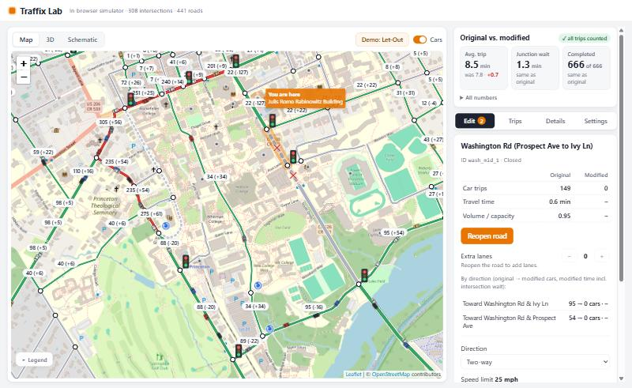
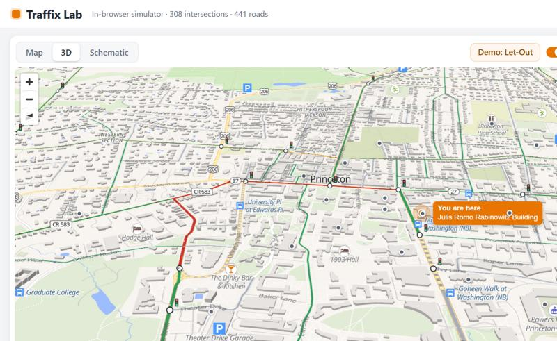
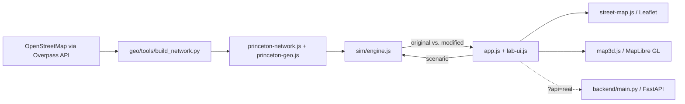

# Traffix Lab

An interactive "what if" traffic map of Princeton. Close a road, add a lane, swap a stop sign for a traffic light or add your own trip, and see how cars reroute and how trip times change compared with the original scenario. Built at HackPrinceton Fall 2026.

_Roads are real, traffic is simulated: street shapes, intersections and mapped signals, stop signs and roundabouts come from OpenStreetMap, while every traffic volume, capacity, travel time and signal timing is a labeled simulation assumption._

**Live app:** [traffixlab.us](https://traffixlab.us) (being set up; until then, run it locally with the steps under [Run the app](#run-the-app))

## Try it

- [Demo: Let-Out](https://traffixlab.us/): click **Demo: Let-Out** to close Washington Rd outside the venue while 200 cars leave for Princeton Station
- [3D view](https://traffixlab.us/?view=3d): the same simulation on a tilted map with 3D buildings and moving cars
- [Schematic view](https://traffixlab.us/?view=schematic): a simple diagram that works without internet

## What it does

- **Road edits.** Close any of 441 road segments, add lanes, or change a road's speed limit, direction or car access.
- **Intersection controls.** Switch any of 308 intersections between a traffic signal, an all-way stop, a two-way stop, a roundabout or no control, and tune a signal's cycle, green split, lost time and walk phase.
- **Your own trips.** Add trips between 22 built-in places or any two points picked on the map, with your own number of cars.
- **Bus shift.** Run the TigerTransit Station Connector and choose what share of let-out trips switch from car to bus.
- **Before and after.** Headline tiles, a full comparison table, a "where trips went" list and a longest-waits list compare every change with the original scenario.

## Why it's different

- **Real streets, honest numbers.** The road network is built from OpenStreetMap, and every traffic number on screen is labeled as an assumption.
- **Drivers react.** Cars pick new routes when you change the network, so closing one road can jam another one blocks away.
- **Runs anywhere.** The simulator runs in the browser with no server or account, and the schematic view works offline.

## Screenshots

| | |
|---|---|
| [](docs/screenshots/map-let-out.jpg) | [](docs/screenshots/view-3d.jpg) |
| Demo: Let-Out on the 2D map. Washington Rd is closed and the average trip rises from 7.8 to 8.5 min. | The 3D view: roads colored by traffic on a tilted map with 3D buildings. |

## Technical details

Everything below is for readers who want to know how the simulation works, run the app, or check our numbers.

### Overview

The default app is a static web page (HTML, CSS and vanilla JavaScript) with its own traffic simulator, `frontend/sim/engine.js`. Each change re-runs two scenarios, the original and the modified one, over the same 15-minute period. Demand is 200 let-out cars from Nassau & Washington to Alexander & University Place, plus 466 background cars on 232 routes that enter from 15 points on the edge of the map. Road travel time rises with cars per lane using the BPR formula (`t0 × (1 + 0.15 × (cars / capacity)^4)`, 100 cars per lane per 15 minutes by default). Each intersection adds wait time based on its control: Webster delay for signals, gap acceptance for two-way stops, a headway model for all-way stops and an entry-capacity curve for roundabouts. Drivers then settle on routes where nobody can save time by switching (user equilibrium, 30 iterations of the method of successive averages). A separate FastAPI backend (`backend/`) models a smaller 10-road core network with closures and extra lanes.

### Controls and links

The page has a top bar, a map card and a side panel:

- **Map / 3D / Schematic:** switch views. Add `?view=3d` or `?view=schematic` to the URL to start in another view.
- **Demo: Let-Out** closes Washington Rd outside the venue. **Cars** turns the car animation on or off.
- **Side panel tabs:** **Edit** (the selected road or intersection, and your changes), **Trips** (custom trips and places), **Details** (where trips went and the longest waits) and **Settings** (bus and assumptions).
- **Backend mode:** add `?api=real` to use the Python backend instead of the in-browser simulator.

Click a road to close it, add lanes or change its speed, direction and car access. Click an intersection to change its control and signal timing. In the **Trips** tab, choose a place or use **Pick on map** for each end of a trip, set the number of cars and add it. **Reset** clears every change to roads, intersections and the bus; custom trips stay until you remove them.

### Architecture



The network was fetched once from OpenStreetMap and built into two JavaScript data files, so the app makes no data requests at run time apart from map tiles. Both simulators accept the same request (`closedRoadIds`, `extraLanesByRoadId`, `signals`, `busShiftPercent`) and return the same `baseline` / `scenario` result, so the page works with either one.

### Run the app

Tested with Python 3.15 on Windows 11, in Chrome and Edge.

```powershell
# Serve the frontend
py -m http.server 5501 --bind 127.0.0.1 --directory frontend
# Then open http://127.0.0.1:5501/

# Optional: the Python backend (10-road core network)
py -m venv .venv
.\.venv\Scripts\python.exe -m pip install -r requirements.txt
.\.venv\Scripts\python.exe -m uvicorn backend.main:app --host 127.0.0.1 --port 8000
# Then open http://127.0.0.1:5501/?api=real
```

The status line should read "In-browser simulator · 308 intersections · 441 roads". The 2D and 3D maps need internet for map tiles; without it the page switches to the schematic. The backend only accepts pages served from port 5501.

### frontend/

**App**
- `index.html`, `styles.css`: page layout and styles
- `app.js`: state, panels, results and the schematic view
- `lab-ui.js`: intersection controls, road settings, trips and settings panels
- `api.js`: sends scenarios to the in-browser simulator or the backend
- `street-map.js`: 2D map (Leaflet)
- `map3d.js`: 3D view (MapLibre GL JS)

**Simulation and data**
- `sim/engine.js`: the in-browser simulator
- `geo/princeton-network.js`: 308 intersections, 441 roads and 15 entry points
- `geo/princeton-geo.js`: street shapes and 22 places

**Checks**
- `tests.html`, `tests.js`: 12 automated checks for the simulator

### Other folders

- `backend/`: FastAPI backend (`main.py`, `princeton_network.py`) and its 6 unit tests (`test_main.py`)
- `frontend/geo/tools/`: scripts that fetch OpenStreetMap data and build the network files
- `testing/`: the core road network spec with map sources (`road-network.md`) and the manual test plan (`test-plan.md`)
- `demo/`: the 2-minute judge demo script
- `docs/screenshots/`: images used in this README
- `.github/workflows/pages.yml`: publishes `frontend/` to GitHub Pages when started by hand from the Actions tab

### Reproducing

Run both sets of checks:

```powershell
# In-browser simulator: open this page and look for "All 12 checks passed"
# http://127.0.0.1:5501/tests.html

# Backend
.\.venv\Scripts\python.exe -m unittest backend.test_main -v
```

The checks cover trip conservation (completed + unserved + bus = total), zero cars on closed roads, closing the demo road making trips slower, an extra lane never making trips slower, the bus being suspended when its route is closed, and no average being reported when no trip can finish.

Rebuild the road network from OpenStreetMap:

```powershell
# Downloads the area 40.322,-74.700 to 40.372,-74.615 from the Overpass API
py -I frontend/geo/tools/fetch_osm_expanded.py osm_big.json
# Builds the two data files the app loads
py -I frontend/geo/tools/build_network.py osm_big.json frontend/geo/princeton-geo.js frontend/geo/princeton-network.js
```

- OpenStreetMap changes over time, so a rebuild may not match the committed files exactly.
- Default numbers on the committed data: original average trip 7.8 min, 666 trips; Demo: Let-Out 8.5 min.

### Known limitations

- Traffic volumes, capacities and signal timings are assumptions. The model has not been calibrated against real traffic counts.
- The simulation covers one 15-minute period. Queues don't carry over in time, and a jam on one road doesn't spill back onto the roads behind it.
- Most roads are modeled as one lane per direction, because lane counts are missing from OpenStreetMap for most Princeton streets.
- 151 junctions with no mapped control get an assumed two-way stop. Your road research should spot-check the busy ones.
- There are no turn restrictions, pedestrians or cyclists. The walk phase only takes green time away from cars.
- Bus riders are removed from car traffic, but bus travel time isn't simulated. The bus is suspended when any road on its route is closed, including during Demo: Let-Out.
- The average trip time covers completed car trips only, so moving short trips to the bus can raise it slightly.
- The Python backend is a smaller, separate model with 10 roads and fixed routes. It doesn't support signals, bus service or custom trips.
- The 2D and 3D maps load tiles from OpenStreetMap and OpenFreeMap and need internet.

### Credits

Everything not listed here was written by our team during HackPrinceton Fall 2026.

| What | Used for | License |
|---|---|---|
| [Leaflet](https://leafletjs.com) 1.9.4 | 2D street map | BSD-2-Clause |
| [MapLibre GL JS](https://maplibre.org) 4.7.1 | 3D map view | BSD-3-Clause |
| [OpenFreeMap](https://openfreemap.org) tiles, built on [OpenMapTiles](https://openmaptiles.org) | 3D basemap and buildings | Free public instance; data ODbL |
| [OpenStreetMap](https://www.openstreetmap.org/copyright) tiles and data, via the [Overpass API](https://overpass-api.de) | 2D basemap, street shapes, road network, mapped traffic controls, places | © OpenStreetMap contributors, ODbL |
| [FastAPI](https://fastapi.tiangolo.com), [Uvicorn](https://www.uvicorn.org), [Pydantic](https://docs.pydantic.dev) | Python backend | MIT, BSD-3-Clause, MIT |
| [GitHub Pages](https://pages.github.com) | Hosting | n/a |

### Team

- **Sizar Ishak:** Python/FastAPI backend.
- **Ben Chuquiruna:** frontend (map views, in-browser simulator, controls and panels).
- **Gabriel Cupo:** road research, testing and demo lead (corridor research, the test plan and the demo script).

### Privacy

The app has no accounts, cookies or analytics, and nothing you do on the page is sent to us. Your changes and trips stay in your browser tab. Loading the map sends standard tile requests to OpenStreetMap, OpenFreeMap and unpkg.com, which may log your IP address.
